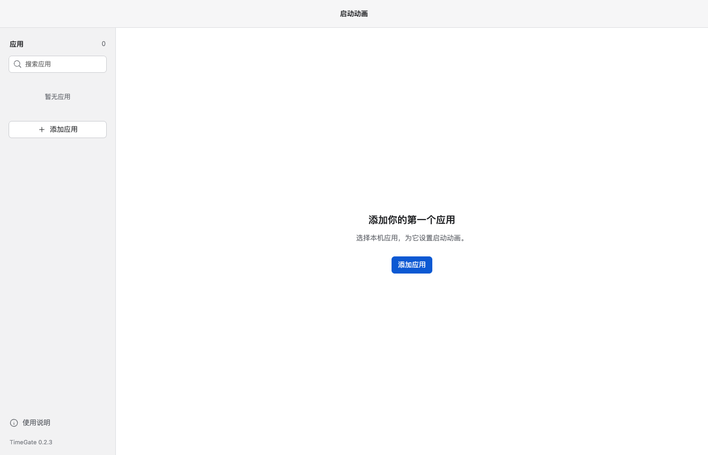

# TimeGate · 应用启动动画

为 macOS / Windows 的本机应用绑定一段程序化启动动画。工作台采用白灰三栏布局：选择应用、预览主题、保存设置。启动画面只显示目标应用的真实图标和名称，不显示 TimeGate 标识或宣传文案。



[查看五种动效的实际录屏](docs/motion-preview.mp4) · [验证记录](VERIFICATION.md) · [开发流程](CONTRIBUTING.md)

## 动画如何工作

素材包提供视觉参考与主题缩略图。播放时由 Three.js / GLSL 实时绘制，生成图片没有作为动画视频或动态背景直接播放。

| 主题 | 运行时实现 |
| --- | --- |
| 光环穿梭 | 三条低亮度银灰圆角轮廓，缓慢展开 |
| 极光流体 | 程序化曲线光带、流动高光与柔光叠加 |
| 几何折叠 | 三维纸片翻转、向外展开 |
| 像素聚合 | 独立三维方块从空间位置聚合成窗口轮廓 |
| 水墨晕染 | 多层噪声、扩散遮罩、纸面纹理 |

动效在运行时绘制，应用图标和名称作为独立层叠加。柔和模式固定空间画面，只做短暂显现。管理界面和默认穿梭效果按第二版生图设计落地；设计图本身不用于播放动画。

## 先看动态效果

安装依赖后生成单文件预览：

```sh
npm ci
npm run build:preview
```

双击 `dist-preview/TimeGate-preview.html`，可以离线切换五种动效、循环播放和全屏观看。脚本、样式和图标均嵌入单个文件，该页面与桌面应用复用同一份 `motion.ts`，只提供动效观看。`docs/motion-preview.mp4` 是该页面实际运行时的录屏裁切。

## 本地运行

使用 Node.js 24（至少 24.14），版本系列在 `.nvmrc` 中指定：

```sh
npm ci
npm run dev
```

如果本机使用 HTTP 代理而 Electron 运行时下载失败，可在配置好 `https_proxy` 后执行：

```sh
NODE_USE_ENV_PROXY=1 node node_modules/electron/install.js
```

Windows PowerShell 可先设置 `$env:NODE_USE_ENV_PROXY='1'`，再运行安装命令。不要将代理凭证提交进项目。

## 使用

1. 点击“添加应用”，选择 macOS 的 `.app` 或 Windows 的 `.exe` / `.lnk`。
2. 在左栏选择应用，选择主题并调整时长、柔和模式，点击“保存绑定”。
3. 点击“启动应用”或应用行右侧的箭头；动画播放时并行请求目标应用启动。启动使用该应用已保存的配置。
4. “播放”和“全屏”预览当前草稿，不启动应用，也不保存修改。
5. 主题、时长和柔和模式按应用保存在本地。切换应用会保留本次未保存的修改；关闭工作台会放弃草稿。Esc 可跳过全屏动画。

内置 Codex、WorkBuddy、DeepSeek 和豆包四个预设。本机应用优先读取自己的图标；预设提供核验过的应用图标，来源见 [素材记录](public/assets/apps/sources.json)。取不到图标时只显示应用名，不回退到 TimeGate 图标。旧配置会继续使用原有通用时长和柔和模式，保存后改为该应用自己的配置。

macOS 会尝试定位常见安装路径；Windows 第一版需要手动定位。DeepSeek、豆包在未绑定客户端时提供网页入口。

## 构建与验证

GitHub Actions 在 macOS 和 Windows 上检查构建、单元测试和预览导出。它不替代解锁桌面上的动画与窗口切换实测。

```sh
npm run build
npm test
npm run test:desktop
npm run pack:mac
npm run pack:win
```

- `build`：类型检查并构建主进程、预加载和渲染界面。
- `test`：检查配置、平台路径和异常输入。
- `test:desktop`：实际启动 Electron，检查五种动效、Esc、配置持久化；在 macOS 上额外编译临时原生应用，验证真实启动和前台交接。macOS 需要 Xcode Command Line Tools。
- `test:preview`：在 Chrome 中播放五种主题，比较图标区域之外的画面变化，并保存截图和录屏；先运行 `npm run build:preview` 与 `npx playwright install ffmpeg`。此项不验证本机应用启动。
- `pack:mac`：输出 macOS 本地 `.app` 测试包。
- `pack:win`：输出 Windows x64 NSIS 安装包。正式验收应在 Windows 环境执行。

公开发布前需配置自己的应用签名与 macOS 公证。目前构建配置用于本地技术验证。

桌面完整验收需要解锁系统。锁屏环境可用 `TIMEGATE_SKIP_FOCUS_ASSERT=1 npm run test:desktop` 检查其余流程，报告会明确保留前台切换为待验证，不能据此宣称完整验收通过。

## 项目结构

```text
src/main/       应用启动、配置持久化、动画窗口生命周期
src/preload/    限定范围的进程通信接口
src/renderer/   工作台、实时动效、全屏播放
src/shared/     主题定义与数据类型
native/         Windows 窗口唤醒辅助脚本
public/assets/  应用原始图标、工具图标与主题缩略图
scripts/        桌面端验证脚本
```

## 当前范围

- 从 TimeGate 内启动。原 Dock、任务栏图标的全局监听尚未接入。
- 通过系统接口请求启动、请求激活。应用内部页面是否已加载完成无法统一判断。
- Windows 的前台激活受系统规则限制，失败时不会反复抢焦点。
- 网页入口交给默认浏览器；动画结束并不表示网页已经加载完成。
- 应用更新或移动后，可用标题栏旁的文件夹按钮重新定位。
- 没有后台账户、云端服务或模型 API 调用。

请结合 [验证记录](VERIFICATION.md) 查看实际通过的平台与结果；构建配置不等于双端实机验收。后续修改遵循 [开发流程](CONTRIBUTING.md)，使用分支和 Pull Request。

## 开源许可

TimeGate 的原创源代码与项目文档使用 [MIT License](LICENSE)。第三方应用图标、名称、商标及依赖的权利另见 [第三方声明](THIRD_PARTY_NOTICES.md)。

欢迎通过 [Issues](https://github.com/Liuhuazhong0801/TimeGate/issues) 反馈问题，或按照 [贡献流程](CONTRIBUTING.md) 提交 Pull Request。
