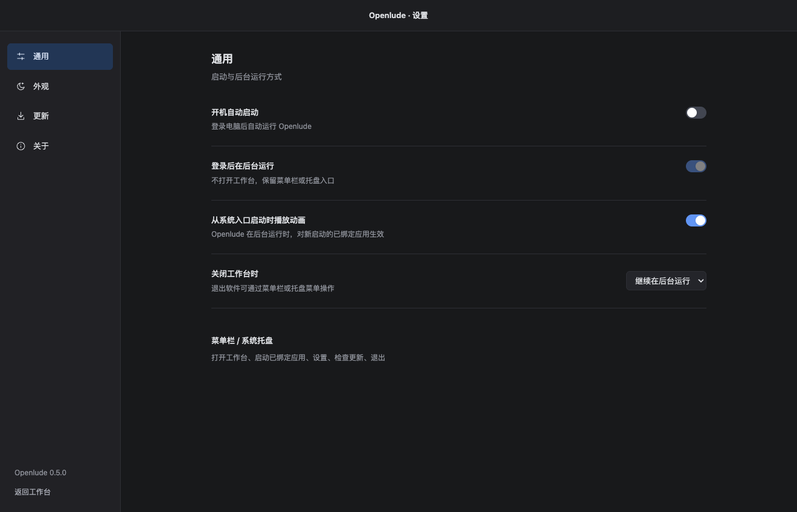

# Openlude · 应用启动动画

为 macOS / Windows 的本机应用绑定一段启动动画。首次打开从空列表开始，由用户添加自己的应用。工作台支持深色、浅色和跟随系统。可选择在动画前单独展示目标应用的真实图标，背景透明。


应用自身图标采用选定的银白小狐狸，macOS、Windows 和“关于”页保持一致；第三方应用仍显示各自图标。

[车窗视角动效](docs/train-window-preview.mp4) · [其他主题历史录屏](docs/styles-preview.mp4) · [验证记录](VERIFICATION.md) · [开发流程](CONTRIBUTING.md)

## 下载预览版

在 [GitHub Releases](https://github.com/Liuhuazhong0801/Openlude/releases) 下载对应平台的安装包：

| 系统 | 文件名 |
| --- | --- |
| Mac Apple Silicon | `Openlude-0.6.2-macos-arm64.dmg` 或同名 `.zip` |
| Mac Intel | `Openlude-0.6.2-macos-x64.dmg` 或同名 `.zip` |
| Windows 64 位 | `Openlude-0.6.2-windows-x64-setup.exe` |

0.6.2 作为预览版提供：Mac 包采用 ad-hoc 签名且未公证，Windows 包未做发布者签名。`SHA256SUMS.txt` 可校验下载文件，`build-info-*.json` 记录版本、架构、源码提交及包的校验值。预览版不进入正式自动更新通道。Windows 构建与进程检测由 CI 验证，完整桌面播放与焦点交接仍需 Windows 实机验收。

## 动画如何工作

共有八个主题。漫画、日漫、纸雕、像素、水墨和星海列车由 Three.js / GLSL 实时绘制，插画与独立图层共同呈现动态场景。两项整活主题直接播放原版奶蛙、肥嘟嘟素材，保留角色、动作、比例与原节奏；没有使用 AI 重绘替代角色。

| 主题 | 运行时实现 |
| --- | --- |
| 漫画疾速 | 原创漫画分镜依次入场、跃起特写、城市远景与速度线，动作段 3.2 秒 |
| 晴空来信 | 日漫海岸背景、镜头推进、独立飞鸟与樱花、海面反光，动作段 4 秒 |
| 星海列车 | 车厢内视角、立体圆角窗框、木质窗沿、玻璃雨滴与窗外分层视差 |
| 纸鹤山海 | 金箔纸雕山海、立体折纸鹤振翅、背景景深与前景花瓣 |
| 像素星航 | 像素飞船、动态尾焰、环状行星、三层星空和城市视差 |
| 水墨晕染 | 多层噪声、扩散遮罩、纸面纹理 |
| 奶蛙大笑 | 原版视频前 4.2 秒，原声可选、默认静音 |
| 肥嘟嘟 | 原版单只袋鼠室内独舞视频前 4 秒，保留原声、默认静音 |

开启「显示应用图标」时，目标图标在透明背景上淡入、短暂停留、淡出，然后淡入动画场景；关闭时直接播放动画。取不到图标时也直接播放动画。该开关按应用保存，预览使用当前草稿。柔和模式固定空间画面并缩短过渡，同时暂停原视频与音频。两项视频的「主题原声」按应用单独保存，旧配置和新安装均默认静音。

动画尾段即开始交接：先在覆盖窗口后方激活目标应用，动画继续运动，整个原生窗口逐渐透明，后方软件随之显露。普通模式的淡出约 650 毫秒，短动画会相应缩短；柔和模式和跳过约 160 毫秒。四个可调时长主题的图标开场与尾段过渡包含在所选时长内。漫画、日漫和原版整活视频按各自节奏播放，开启图标时额外增加约 0.9 秒；切换到这些主题不会改写其他主题的时长设置。启动请求较慢时，动画继续绘制并有退出时限；第三方应用内部页面是否加载完成仍由该应用决定。

## 先看动态效果

安装依赖后生成单文件预览：

```sh
npm ci
npm run build:preview
```

双击 `dist-preview/Openlude-preview.html`，可以离线切换八个主题、循环播放和全屏观看。脚本、样式、图标、插画与原版视频均嵌入单个文件，该页面与桌面应用复用同一份 `motion.ts`，只提供动效观看。文档中的 MP4 使用相同实时场景录制，用于展示主题画面；原生窗口交接需要在桌面应用中查看。

## 本地运行

使用 Node.js 24（至少 24.14），版本系列在 `.nvmrc` 中指定：

```sh
npm ci
npm run dev
```

如果本机使用 HTTP 代理而 Electron 运行时下载失败，可在配置好 `https_proxy` 后执行：

```sh
NODE_USE_ENV_PROXY=1 node node_modules/electron/install.js
```

Windows PowerShell 可先设置 `$env:NODE_USE_ENV_PROXY='1'`，再运行安装命令。不要将代理凭证提交进项目。

## 使用

1. 点击“添加应用”，选择 macOS 的 `.app` 或 Windows 的 `.exe` / `.lnk`。
2. 在左栏选择应用，通过居中的主题栏选择主题（左右按钮、方向键或横向滑动均可），调整可用的时长、柔和模式，点击“保存绑定”。
3. 点击上方“启动应用”，或保持 Openlude 在后台后从 Dock、桌面、开始菜单新启动该应用，都会播放已保存的动画。动画播放时应用并行启动；已运行的应用切回前台不重复播放。
4. “播放”和“全屏”预览当前草稿，不启动应用，也不保存修改。
5. 主题、时长、图标开场、主题原声和柔和模式按应用保存在本地。切换应用会保留本次未保存的修改；关闭工作台默认隐藏到后台并保留草稿；退出 Openlude 才会放弃未保存的修改。Esc 可跳过全屏动画。
6. 悬停或用键盘聚焦左侧应用行，点击出现的删除图标即可从列表移除，原软件不会卸载。
7. 点击左下角“设置”进入完整设置页面，左侧分类为“通用、外观、更新、关于”。点击左下角“返回工作台”回到应用列表；macOS 也可按 `⌘,` 打开设置。

桌面应用不预置、扫描或自动添加任何软件。本机应用读取自身图标；名称用于工作台识别，不出现在开场动画中。独立网页预览保留四个示例图标用于演示，来源见 [素材记录](public/assets/apps/sources.json)，它们不会加入桌面应用列表。

从 TimeGate 升级时，若 Openlude 尚无配置，会复制原配置并保留旧文件；已经添加的应用及各自设置会保留。更早的 v1 配置会先备份，再清理未绑定的旧预设。移除最后一个应用后会回到添加引导，重启不会重新填入预设。

0.6.2 移除猫猫开门、深海鲸游；若旧配置绑定过这两个主题，会先备份，再切换为星海列车，应用路径与偏好保持不变。

## 系统入口启动

“通用 → 从系统入口启动时播放动画”默认开启。Openlude 运行时，macOS 通过系统应用启动通知检测已绑定的 `.app`；Windows 按配置的 `.exe` 或 `.lnk` 目标检测新进程。首次启用时已运行的应用不会补播，从 Openlude 内部启动也不会再触发第二次动画。移除应用或关闭检测立即生效。

这属于启动通知后的动画覆盖，不会暂停第三方应用的启动。快捷启动的应用可能先显示自身窗口，再出现覆盖动画；如果希望明确先出现动画，可使用工作台“启动应用”。macOS 安装包已包含原生组件，使用时不需要安装 Xcode；从源码构建 macOS 版本需要 Xcode Command Line Tools。Windows 启动检测与窗口交接仍需 Windows 实机验收。

## 设置与更新

外观默认跟随系统，也可选择深色或浅色。开机启动通过系统登录项接口设置，需要使用打包后的应用；此选项默认关闭。“登录后在后台运行”决定登录时是否显示工作台。关闭窗口默认继续在后台运行，也可改为直接退出；菜单栏 / 系统托盘提供打开工作台、启动已绑定应用、设置、检查更新和退出。



默认自动检查 GitHub Releases，每次启动后和运行期间定期检查。也可手动检查、下载更新，并选择重启安装；不会自动下载或中断工作。尚无正式发布时会如实显示“尚未发布正式版本”。

自动更新使用 `electron-updater`。发布需同时提供 macOS 的 ZIP、DMG 与 `latest-mac.yml`，或 Windows NSIS 安装包与 `latest.yml`，并保持应用身份和签名一致。当前本地 macOS 测试包采用 ad-hoc 签名，正式 macOS 自动更新仍需 Developer ID 签名、公证及一次真实升级验证。

## 构建与验证

GitHub Actions 在 macOS 和 Windows 上检查构建、单元测试和预览导出；检查通过后构建 Mac arm64/x64 与 Windows x64 的预览安装包。它不替代解锁桌面上的动画与窗口切换实测。

```sh
npm run build
npm test
npm run test:desktop
npm run test:external
npm run test:regressions
npm run test:windows-observer
npm run pack:mac
npm run pack:win
```

- `build`：类型检查并构建主进程、预加载和渲染界面。
- `test`：检查配置、平台路径和异常输入。
- `test:desktop`：实际启动 Electron，检查八个主题、Esc、配置持久化；在 macOS 上额外编译临时原生应用，验证真实启动和前台交接。macOS 需要 Xcode Command Line Tools。
- `test:external`：macOS 上使用独立临时应用，通过真实系统启动入口验证后台播放、焦点交接、重复触发保护、开关、移除和原生组件恢复，不修改用户绑定。
- `test:preview`：在 Chrome 中播放八个主题，比较图标区域之外的画面变化，并采样图标淡入与淡出的透明度，保存截图和录屏；先运行 `npm run build:preview` 与 `npx playwright install ffmpeg`。此项不验证本机应用启动。
- `pack:mac`：使用明确的 ad-hoc 签名参数输出 macOS 本地 `.app` 测试包，不发布到 GitHub。
- `pack:preview -- --arch arm64`（或 `x64`）：在对应系统构建预览安装包并输出 SHA-256、源码提交记录；先运行 `npm run build`。Mac 生成 DMG 与 ZIP，Windows x64 生成 NSIS 安装包，不自动发布。
- `pack:release`：要求 Developer ID Application 证书和 Apple 公证凭据，强制正式签名；缺少凭据时停止。只生成 DMG、ZIP 与更新元数据，不自动发布。
- `assets:thumbnails`：在安装 Chrome 后重新生成 256×144 WebP 缩略图；普通构建直接使用生成文件。动画原素材不作缩放或重编码。
- `test:regressions`：隔离验证写盘失败的一致性、视频取消、加载中释放、主题复用和高 DPI 渲染预算。
- `test:windows-observer`：在 Windows 验证单条配置握手、无后续输入时的进程检测、快捷方式与退出；其他系统可通过 `OPENLUDE_PWSH` 指定 PowerShell 执行输入协议检查。
- `pack:win`：输出 Windows x64 NSIS 安装包。正式验收应在 Windows 环境执行。

公开发布前需配置自己的应用签名与 macOS 公证。本地包与正式包使用不同的签名策略。正式包可使用 `CSC_LINK` / `CSC_KEY_PASSWORD` 指定证书，或使用钥匙串中的 Developer ID；公证支持 `APPLE_ID` / `APPLE_APP_SPECIFIC_PASSWORD` / `APPLE_TEAM_ID`、Apple API Key，或 `APPLE_KEYCHAIN_PROFILE`。可先运行 `node scripts/pack-release.mjs --check` 验证前置条件。

桌面完整验收需要解锁系统。锁屏环境可用 `OPENLUDE_SKIP_FOCUS_ASSERT=1 npm run test:desktop` 检查其余流程，报告会明确保留前台切换为待验证，不能据此宣称完整验收通过。

0.6.1 将动画画布限制在 2560×1440 的总像素预算内，保留工作台文字和目标应用图标的原生清晰度。图标开场期间暂停重复的场景绘制；切换到同一主题时复用资源；空工作台不创建 WebGL 场景。主题栏使用独立的小尺寸缩略图并按可见范围加载。

## 项目结构

```text
src/main/       应用启动、配置持久化、动画窗口生命周期
src/preload/    限定范围的进程通信接口
src/renderer/   工作台、实时动效、全屏播放
src/shared/     主题定义与数据类型
native/         macOS 应用启动观察器源码、Windows 启动检测与唤醒脚本
public/assets/  应用原始图标、工具图标、主题插画、缩略图与原版视频
scripts/        桌面端验证脚本
```

## 当前范围

- 支持工作台启动，以及 Openlude 在后台时检测系统入口的新应用启动。
- 通过系统接口请求启动、请求激活。应用内部页面是否已加载完成无法统一判断。
- Windows 的前台激活受系统规则限制，失败时不会反复抢焦点。
- 兼容旧配置中用户自建的网页入口，新版本只提供本机应用添加。
- 应用移动导致路径失效后，从列表移除并重新添加。
- 没有后台账户、云端服务或模型 API 调用。

请结合 [验证记录](VERIFICATION.md) 查看实际通过的平台与结果；构建配置不等于双端实机验收。后续修改遵循 [开发流程](CONTRIBUTING.md)，使用分支和 Pull Request。

## 开源许可

Openlude 的原创源代码与项目文档使用 [MIT License](LICENSE)。第三方应用图标、名称、商标及依赖的权利另见 [第三方声明](THIRD_PARTY_NOTICES.md)。

欢迎通过 [Issues](https://github.com/Liuhuazhong0801/Openlude/issues) 反馈问题，或按照 [贡献流程](CONTRIBUTING.md) 提交 Pull Request。
